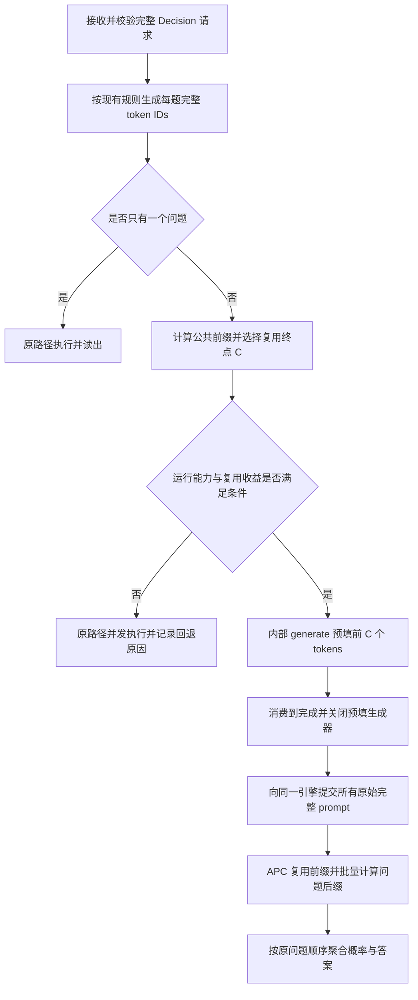

# SystemOne 27B Decision 共享前缀时延优化设计

日期：2026-10-15。状态：方案已确认，尚未实施；27B NPU 时延、混合状态复用和容量验收均为 `pending_remote`。

本方案面向使用模型原生 LM head 读取答案 token logits 的 `/v1/systemone` 服务。默认目标为 Qwen3.6-27B，并覆盖具有相同混合注意力结构的 Qwen3.5 系列。核心路径是先计算一次公共 token 前缀，再批量计算各问题的后缀；优先通过 endpoint 编排复用原生 Automatic Prefix Caching（APC），按实测瓶颈补充分组缓存管理和读出优化。

## 1. 目标与适用范围

请求到达时没有可复用的前缀缓存，一个 state 带 20 个 question 的完整 HTTP 耗时应不超过同一 state 带 1 个 question 的 150%：

\[
T_{20} \le 1.5 T_1
\]

时延从客户端发送请求到收到完整答案计时，包含规划、分词、共享前缀预填、排队、状态复制、全部问题计算、logits 读出和结果返回。内部预填请求的耗时也计入，不能在开始计时前预热 state。

冷缓存指本次输入没有可复用的缓存；模型权重、算子编译和运行时已经预热。模型进程冷启动不属于本目标。首轮受控验收使用一个 HTTP 父请求、DP=1 和独占测试实例，随后增加其他父请求与 Generation 混跑。

目标保留逐组 `T20/T1 <= 1.5` 的判定，同时报告比值分布和超标样本。有限实验通过不构成任意输入长度、任意外部排队和内存压力下的全局保证。发布范围必须记录 state、问题后缀、候选数量及外部负载的边界；遇到短 state 或很长的问题时，单独报告结果，不能通过排除失败样本宣称全面达标。

### 1.1 实现基线

| 项目 | 基线或边界 |
|---|---|
| SystemOne logits 读出 | `F00L42/vllm-ascend` 的 `ecd7d1263f6f2ca33d8a92abdecf2c76e9b12006` |
| vLLM-Ascend 发布基线 | `v0.27.1rc1` |
| vLLM | `v0.27.1`；实施时另记录实际安装包、Git SHA 和能力探测结果 |
| 首轮模型与执行 | Qwen3.6-27B、BF16、V1 runner、TP=4、DP=1、eager、同步调度 |
| 读出语义 | 原模型 LM head，读取 A–P 中本题候选的分数，再按既有温度归一化 |
| 协议 | 保持 question 独立、原 prompt token IDs、答案结构和逻辑 usage 计数 |

本工作区已有的 [Kev 原生决策引擎设计](kev_systemone_engine.md) 描述 pooling 与 pointer head。本文的实现基线是另一个 logits 读出分支；后文源码位置均按该基线解释，不能把当前工作区的 pointer 实现当作 logits 路径直接修改。

首版沿用 logits endpoint 的运行限制：不启用量化或 speculative decoding，保持 `raw_logprobs` 和 `enable_reduce_sample=false`。混合 APC 使用 chunked prefill 与 `mamba-cache-mode=align`。扩展到其他模型结构时，重新验证缓存类型和状态复制接口。

## 2. 现有数据与机制

[910B4 latency tests](https://github.com/F00L42/vllm-ascend/discussions/2) 中，每个 HTTP 请求包含 3 个 question。其单 HTTP 数据如下，单位为秒：

| 输入 | 冷缓存耗时 | PrefixCacheHit 耗时 | 冷热耗时比 |
|---|---:|---:|---:|
| 16K | 7.8668 | 0.9445 | 8.33 |
| 32K | 16.1605 | 0.8150 | 19.83 |

三个 HTTP 并发时，32K 冷请求依次约在 16.917、32.656、48.317 秒完成。短输入从一个 HTTP 增加到三个时，整组墙钟耗时约从 508.8 ms 变为 517.1 ms。长输入的等待与短输入的批量收益，需要分别分析。

这些结果支持优先优化前缀复用，但不能证明首次到达的三个问题分别重复计算了多少 state，也没有提供单问题基线。Discussion 未完整记录 checkpoint 和启动配置，其绝对秒数不直接迁移为 27B 时延预测。`6 x 16K Cold` 中一个请求超时，8088.2 ms 仅是成功请求的统计，不作为双请求吞吐改善依据。

### 2.1 当前请求路径

`plan_request()` 为每题生成完整 prompt。user JSON 中 evidence 位于 criterion 和 options 前，便于公共前缀匹配。`SystemOneService._execute()` 为每题创建独立的 `generate(max_tokens=1)`，同时请求候选 `logprob_token_ids`，并发消费结果后按问题顺序聚合。

不同 question 的最终 token 序列写为：

\[
R_i = P + S_i
\]

`P` 是所有完整序列的最长公共 token 前缀，包含模板、固定指令和共同 evidence 等内容；`S_i` 包含问题、选项、模板尾部及答案起始标记中未共享的部分。不能把裸 state 的字符数或独立编码长度直接当作 `P`。

当前 endpoint 没有公共前缀完成屏障。同一 HTTP 中的问题同时提交，并不保证公共前缀只计算一次。是否复用取决于首次调度时可用的缓存、混合状态保存位置、执行副本与缓存留存情况。

### 2.2 组批与计算量

vLLM 每轮为请求分配新增 token 数 `q_i`，将它们打包为总长 `T=sum(q_i)` 的输入；`hidden_states` 的有效形状为 `[T, hidden_size]`。eager 仍然批量执行模型，不表示逐题完整串行执行。

在没有实际复用时，公共前缀的多份输入仍对应多份计算。复用后，公共 token 不再进入子请求的新增 token 张量，但问题后缀的 Full Attention 仍需访问公共 KV。

对于公共长度 `p`、后缀长度 `s_i`，共享前缀后的有效 causal Query–Key 配对数为：

\[
A = \frac{p(p+1)}{2}
    + \sum_i\left(p s_i + \frac{s_i(s_i+1)}{2}\right)
\]

这个表达式解释 Full Attention 工作量，不是整模型时延公式。GDN 通过递推状态和分块算法处理后缀，需另测 token 计算、状态读写及复制开销。

## 3. 时延预算与可行条件

共享路径的时延按可测阶段拆解：

\[
T_N = T_{\mathrm{plan},N} + T_{\mathrm{queue},N}
    + T_P + T_{\mathrm{fork},N} + T_{\mathrm{suffix},N}
    + T_{\mathrm{readout},N} + T_{\mathrm{return},N}
\]

单问题走一次正常执行，不人为添加额外预填流程。20 问题的额外工作必须落在 `0.5*T1` 的预算内。共享 state 不会消除 20 个问题各自的后缀和最终 hidden state 计算。

假设各题后缀均为 `s` 个 tokens，先只比较新增 token 工作量：

\[
\frac{p+20s}{p+s} \le 1.5
\quad\Longleftrightarrow\quad p \ge 37s
\]

| 公共前缀 tokens | 每题后缀 tokens | 理想新增 token 工作量比 |
|---:|---:|---:|
| 16384 | 256 | 1.29 |
| 32768 | 256 | 1.15 |
| 16384 | 512 | 1.58 |

这是等效 token 成本假设下的筛查式，不是硬件上的必要条件或时延预测。批量利用率、Full Attention、GDN、head、通信和固定开销都会改变结果。它提示先聚焦长 state、短问题，同时实测短 state 场景。

### 3.1 不可复用的公共尾部

若只能复用前 `c` 个 tokens，公共尾部 `r=p-c` 要由每题分别计算，新增 token 工作量变为：

\[
W_{20} = c + 20(r+s)
\]

在相同粗算假设下，满足 1.5 倍工作量要求需 `c >= 37(r+s)`。例如 `c=16384`、`r=1024`、`s=256` 时，工作量比约为 2.38；复用整个 `p=17408` 的公共前缀时约为 1.28。因此，实际保存和命中的终点是关键观测项。

## 4. 阶段一 Endpoint 显式预填与原生 APC

### 4.1 执行流程



endpoint 不传递 K/V 张量、不改写子问题的 token 序列，也不自行设置 `num_computed_tokens`。它建立执行顺序，由引擎负责查找、分配和复制缓存。

### 4.2 选择预填终点

必须区分物理页大小 `B`、前缀匹配粒度 `h` 和有效状态保存位置。`h` 不是 CLI `block-size` 的同义词；能匹配某个哈希边界，也不表示那里已经保存了可用的 GDN 状态。

先求 `L=token_lcp(full_prompt_ids)`。在已经验证“以该长度结束的预填请求可以保存完整混合状态”的边界集合中，选择最大的 `C`，并满足：

\[
0 < C \le \min\left(|L|, \min_i(|R_i|-1)\right)
\]

当能力探测确认每个 `h` 边界都能作为此类 producer 的有效终点时，可使用：

\[
C = h\left\lfloor
    \frac{\min(|L|,\min_i(|R_i|-1))}{h}
    \right\rfloor
\]

首版保守使用已验证的公共物理或调度边界。精细模式再验证 `prefix_match_unit=32/128` 等设置的完整路径，不能仅凭配置字段存在就开启。

### 4.3 内部预填请求

内部请求使用 `prompt_token_ids=L[:C]`、`max_tokens=1`、`temperature=0`、`ignore_eos=True`、`detokenize=False` 和 `FINAL_ONLY`，不请求候选 logprobs。消费生成器直到 `finished`，然后再提交子问题。

预填输入恰好为 `C` 个 tokens。首步从第 `C` 个输入 token 的 hidden state 采样一次；采样输出不再次送入模型，缓存状态仍对应前 `C` 个输入。无需任意追加一个 token。消费者的 `prompt_length-1` 缓存查找上限通过上一节的长度约束满足。

这个预填请求仍会执行当前路径中的 LM head 和采样；不请求 logprobs只能减少相关结果处理，不能宣称绕过完整 head。后续引擎 `prefill_only` 能力才负责去掉这部分开销。

以下伪代码说明编排职责，辅助函数和分组上下文均为拟新增实现：

```python
plans = original_plan_request(request)
if len(plans) == 1:
    return await original_execute(plans, request)

capability = inspect_shared_prefix_capability(engine)
boundary = choose_verified_boundary(plans, capability)
if not should_share(boundary, plans, capability):
    return await original_execute(plans, request)

async with decision_group_lifecycle(request) as group:
    group.bind_one_engine_replica()
    await group.prefill_to_finished(
        token_ids=plans[0].token_ids[:boundary],
        max_tokens=1,
        cache_salt=request.cache_salt,
    )
    return await group.execute_original_prompts(plans)
```

### 4.4 路由 生命周期和失败处理

预填及全部子问题必须使用相同模型、缓存身份和 `cache_salt`，并进入同一个 DP 引擎。首版固定 DP=1；扩展 DP 时，要通过实际安装版本支持的引擎路由接口实现父请求亲和性，不能依赖负载均衡恰好分配到同一副本。

只有预填执行完成，状态才可供分支读取。不能把调度器已分配页、哈希已登记或同一步有另一个 producer 当作完成信号。所有 TP ranks 必须遵守同一复制与执行顺序。

阶段一使用默认稠密状态留存，保持足够缓存余量。自定义稀疏留存可能只保留 producer 的 `prompt_length-1` 所在边界，使恰好位于 `C` 的物理边界状态失效；该配置要单独验证或由阶段二显式保留 `C`。即使使用默认留存，endpoint 也不能保证缓存不被其他流量淘汰。

父请求取消时，在 `finally` 中关闭预填和全部子问题生成器，并验证它们触发原生 abort、释放引用。预填失败时不启动分支；任一问题失败时返回既有错误语义，不伪造概率或返回不完整答案。

单问题、无有效公共边界、APC 关闭或运行能力不足时，选择原路径并记录原因。回退确保功能可用，不视为时延达标。预填完成后若实际命中不足，按真实执行结果返回并记录复用失败，不盲目重复预填。

## 5. 阶段二 引擎分组缓存管理

当阶段一在目标输入范围内达标且缓存命中稳定，可以先交付阶段一。只有观测到淘汰、路由、边界或调度问题时，再增加对应能力，优先复用既有 APC、部分页写时复制和 GDN state copy。

### 5.1 拟新增 DecisionGroup

内部组状态为 `PREFILL -> SNAPSHOT_READY -> BRANCH_EXECUTION -> COMPLETE`，并有失败和取消出口。组记录父请求 ID、问题 ID、公共 token 长度、有效快照长度、引擎副本、缓存身份及所有资源引用。

| 组件 | 拟新增职责 |
|---|---|
| Endpoint 与 engine 请求通路 | 一次提交父组和分支信息，传播取消、priority 和 trace |
| Scheduler | 公共前缀只调度一次，等待快照就绪后释放分支；规划分支执行批次 |
| Cache manager | 保留公共页和状态快照，管理引用计数、私有尾页及内存不足处理 |
| Runner | 执行必要的设备复制，设置各分支绝对位置和状态索引，再执行原有模型 |
| 结果通路 | 保留问题顺序与失败语义，聚合完整答案后释放父组 |

这是新增设计，不代表当前已有完整的 `DecisionGroup` 或 `prefill_only` API。首版原型不复制模型 backbone，也不另建推理进程；依照仓库约定通过最小 patch、继承或组合接入现有调度和 runner。

### 5.2 Attention KV 与 GDN 状态

Full Attention 的公共完整页通过引用共享，各分支使用自己的 block table。若分支要在公共尾页继续写入，先执行写时复制，避免一个问题覆盖其他问题的缓存。

GDN 同时涉及卷积状态和递推状态。快照必须对应处理完同一前缀位置的完整混合状态；为每个继续执行的分支建立独立可写状态，或通过经验证等价的原生复制机制初始化。20 个问题不能共同修改同一份 GDN state。

公共 Attention KV、GDN 卷积状态和递推状态全部完成后，才发布 `SNAPSHOT_READY`。设备复制源在复制完成前不能释放或复用。组内所有分支结束、失败或取消后，释放对应引用；避免通过全量复制 20 份前缀 KV 获得表面上的功能正确。

先支持现有边界。若残余公共尾部仍消耗过多时延，再扩展到精确 LCP 终点快照；这需要同时解决部分 Attention 页、GDN 保存位置和 runner bookkeeping，不能只修改 `num_computed_tokens`。

### 5.3 分支调度和内存

20 个问题各有 256 个剩余 tokens 时，有效新增输入总长为 5120，hidden 形状为 `[5120, hidden_size]`。各分支的位置从快照长度继续，Full Attention 读取相应公共 KV，GDN 从各自状态继续。

不要求在一次 forward 中同时完成公共前缀和所有分支。公共前缀可以分多个 chunks，后缀也可以分批；要求是实际只计算一次可共享前缀，并把剩余执行控制在时延预算内。

缓存容量要包括一份公共 KV、私有尾页、各活动分支的 GDN 状态、问题后缀 KV、复制临时区及模型激活。`max-num-seqs=32` 不等于已经验证 32 份状态和长上下文能驻留。内存不足时，明确采用有限分批或拒绝准入，并记录对应时延和错误；不静默退化为 20 次长前缀重算后仍报告正常共享。

受控验收通过后，再加入父组级准入、分支执行额度及与外部请求的公平调度。在有其他流量的测试中，记录父组从入队到全部完成的时间，不能仅统计分支设备执行时间。

## 6. 部署参数实验

先固定执行路径，逐项扫描，不把多个开关同时改变后的收益归因给其中一个参数。

| 参数 | 实验值或安排 | 目的 |
|---|---|---|
| `max-num-seqs` | 20、32；8 作为现状对照 | 避免 20 个问题仅因序列额度被迫分成多批 |
| `max-num-batched-tokens` | 2048、4096、8192、16384 | 比较前缀分块、后缀批量、激活峰值和 KV 余量 |
| `prefix_match_unit` | 保守边界后验证 32、128 | 减少不可复用公共尾部；要求完整 CoW 和混合状态支持 |
| TP 与 DP | 先 TP=4、DP=1，再比较容量允许的 TP=2 | 分离通信、计算和内存影响；DP 扩展先解决父组亲和性 |
| eager 与图 | eager 通过后单独比较受支持的 prefill 图路径 | 测量算子下发开销；`FULL_DECODE_ONLY` 不直接优化普通多 token prefill |
| 同步与异步调度 | 同步通过后独立验证 | 观察 CPU、设备和结果处理重叠收益 |

8192 的 token 预算可以容纳 20 x 256 的有效后缀，但不保证调度器实际一轮执行完；对齐、额度、其他请求和内存都会影响调度。参数扫描同时记录绝对 `T1` 和 `T20`：单题变快后，允许增加的 50% 预算也会缩小。

## 7. 读出与 CPU 开销优化

阶段一保留当前完整 LM head，先隔离共享前缀的收益。规划和分词耗时单独记录；初版仍逐题产生最终 token IDs，后续减少重复序列化和分词时，必须证明结果与原完整 prompt 编码一致。不能直接拼接分别编码的 state 和问题，忽略 tokenizer 边界。

### 7.1 跳过无用 head 和采样

当前非投机 runner 对部分 prefill 的 chunk 尾部也计算 logits 和采样，随后丢弃未完成请求的采样结果。优化需要区分：

| 请求阶段 | 目标行为 |
|---|---|
| 仅预填公共前缀 | 推进缓存与状态，完成后发布快照 |
| 未完成的 Decision chunk | 推进状态，不运行无用 head 和 sampler |
| 完成 prompt 的 Decision | 在答案位置读取候选分数并完成请求 |
| Generation | 继续使用正常完整 head、采样和输出流程 |

跳过采样必须同时调整结果 bookkeeping，不能破坏调度推进、结束判断或 GDN 状态保存。首版可以只支持纯 Decision；混合批次扩展时，所有 TP/PP ranks 的 collective 顺序必须一致。

### 7.2 候选行投影

候选 head 使用原模型 LM head 中对应 token 的权重行，不训练新的 readout。启动时按实际 tokenizer ID 和 TP 分片提取候选权重，缓存布局；避免每个请求重复选行或搬运。处理词表 padding 和分片边界时不能使用简单的 `token_id // shard_width` 推断归属。

候选概率仍为 `softmax(candidate_logits / temperature)`。现有候选 logprob 中减去的全词表归一化常数会在候选 softmax 中抵消，因此可保持既有语义，但需验证数值误差和候选 mask。

新增内部 `candidate_scores` 结果通路，不能把 16 维分数伪装成正常全词表 logits。纯 Decision 的最终行绕过完整词表投影和相关通信；Generation 保持完整路径。完整 head 权重若仍供 Generation 使用，就继续驻留显存；这项优化主要减少执行工作，不能据此宣称显存容量倍增。

移除冗余 `logprobs=len(candidate_token_ids)`、只保留精确候选请求，可以另做小实验；该调整本身不会绕过完整 LM head，仍须验证实际安装版本的输出合同。

## 8. 可观测性与验收

### 8.1 必须记录的数据

| 层次 | 字段或度量 | 用途 |
|---|---|---|
| HTTP 父请求 | parent ID、question 数、完整 E2E、规划与返回时间、错误 | 对应真实服务目标 |
| 共享规划 | LCP 长度、选择的 C、残余公共尾部、匹配粒度、物理块大小、回退原因 | 定位边界损失 |
| 预填 | 入队、首次执行、完成时间、实际计算 tokens、快照发布位置 | 确认预填只做一次且在计时内 |
| 子问题 | question ID、DP rank、实际 cached tokens、新计算 tokens、完成时间 | 确认命中和最慢分支 |
| 每轮调度 | request IDs、scheduled tokens、computed tokens、总 tokens、图模式 | 解释批量与等待 |
| 混合状态 | 复制次数与字节数、源/目标生命周期、公共页保留、私有状态峰值 | 排查复制与状态污染 |
| 资源 | 缓存占用、淘汰、抢占、重算、激活峰值、TP 通信 | 定位压力下退化 |

`usage.input_tokens` 继续是所有完整 prompt 的逻辑 token 数之和，命中缓存也不减少；用它判断设备实际工作量会得出错误结论。内部预填不增加对外业务 output token 计数，其资源开销通过独立指标记录。

阶段一保守边界的冷请求，预期设备新增 token 工作量约为 `C + sum(len(R_i)-C)`。记录实际值并解释额外重算、对齐或抢占；不只看全局 cache hit rate。

### 8.2 性能矩阵和公平基线

| 维度 | 首轮覆盖 |
|---|---|
| state 长度 | 16K、32K；补充短 state 和物理块附近长度 |
| 每题后缀长度 | 128、256、512；统一按完整 token 序列扣除 LCP 计算 |
| question 数 | 1、3、10、20 |
| 边界 | C 对齐、物理块内终点、较长残余公共尾部 |
| 缓存 | 每组逻辑冷缓存、重复请求热缓存 |
| 方案 | 原始并发、专用前缀预填、首题后扇出对照、分组管理及读出优化 |
| 负载 | 单父请求后增加多父请求和 Decision/Generation 混跑 |

对每个固定输入，使用同一权重、tokenizer、dtype、部署配置和代码版本，分别测单题与 20 题。单题基准从 20 题中预先固定选择，长度具有代表性，同时保留每题独立执行的基线以识别问题差异。两种题数均需独立清空目标缓存或使用新的 salt，组内预填与子题则共享同一个 salt。

不能用关闭 APC 模拟冷缓存，因为这会同时禁用本次请求内部的复用。不能先测单题再让 20 题复用它的缓存。随机交错两种题数的实验顺序，保留原始记录，报告配对比值、P50/P95/P99、超标率、绝对时延和吞吐。超时与失败单列并计入未通过样本，不能只对成功请求计算验收结果。

每个发布输入范围都要给出 `T20/T1 <= 1.5` 的逐组结果和超标明细。百分位汇总用于描述分布，不能替代原比例目标；若改用某个统计 SLO，需另行确认。与此同时比较原版与优化版的绝对耗时，禁止故意减慢优化版单题来改善比值。

### 8.3 正确性和故障场景

保持每题完整 prompt token IDs、答案温度、候选顺序、Score legend 和响应顺序。共享路径与独立完整 prompt 路径比较候选分数、概率及最终答案，数值容差依据固定 dtype 的基线波动制定；近似平局单独分析，不用任意放宽容差掩盖偏差。

必须覆盖不同问题顺序、同题重复、单题独立重跑、不同候选数量、LCP 为空、某个完整 prompt 是其他 prompt 的前缀、token 边界和模型长度上限。重排问题后不应出现跨问题状态污染。

故障场景包括预填中取消、分支中取消、一个分支失败、缓存淘汰、内存不足、GDN 复制尚未完成时取消，以及 DP 亲和性失效。检查无遗漏答案、无重复提交、无缓存引用泄漏、无跨 rank 死锁；性能回退要有可定位原因。

## 9. 交付阶段与进入条件

| 阶段 | 交付内容 | 完成依据 |
|---|---|---|
| P0 基线与能力探测 | 固定实际版本和输入；采集 1/20 题轨迹；确认匹配粒度、状态保存与复制路径 | 能解释实际计算量、等待、边界和完整 E2E |
| P1 Endpoint 预填 | LCP、有效 C、预填屏障、原始 prompt 扇出、取消和回退 | 保守边界正确性及冷缓存实际复用通过 |
| P2 细粒度与参数 | 验证部分块 CoW/GDN copy，扫描批量预算和序列额度 | 各目标输入范围有时延比、绝对时延和容量结果 |
| P3 条件性引擎扩展 | 针对未达标原因实现分组路由、状态保留、准入或更精确快照 | 对应退化原因消除，并通过压力与取消测试 |
| P4 读出和规划优化 | 跳过无用 head/采样，候选行投影，减少重复 CPU 工作 | 数值合同保持，profiler 证明热路径执行工作减少 |

P1/P2 达标时可交付该范围，不为实现全部阶段而扩大改造。若仍未达标，按 `规划/等待/前缀重算/状态复制/后缀/head` 的实际占比决定下一步，不以 theoretical FLOPs 代替端到端验收。

## 10. 源码与资料

以下链接按职责定位。实施前记录服务器中实际安装源码的 commit 和能力；文档或版本号相同不替代运行路径验证。

| 资料 | 对应内容 |
|---|---|
| [SystemOne serving 固定提交](https://github.com/F00L42/vllm-ascend/blob/ecd7d1263f6f2ca33d8a92abdecf2c76e9b12006/vllm_ascend/entrypoints/systemone/serving.py) | runtime 限制、每题 generate、候选分数和取消通路 |
| [SystemOne protocol 固定提交](https://github.com/F00L42/vllm-ascend/blob/ecd7d1263f6f2ca33d8a92abdecf2c76e9b12006/vllm_ascend/entrypoints/systemone/protocol.py) | evidence 顺序、完整 prompt、候选语义和 usage |
| [NPU runner 固定提交](https://github.com/F00L42/vllm-ascend/blob/ecd7d1263f6f2ca33d8a92abdecf2c76e9b12006/vllm_ascend/worker/model_runner_v1.py) | 打包输入、部分 prefill 的 logits_indices、compute_logits |
| [GDN 固定提交](https://github.com/F00L42/vllm-ascend/blob/ecd7d1263f6f2ca33d8a92abdecf2c76e9b12006/vllm_ascend/ops/gdn.py) | 初始状态、分块计算和最终递推状态写回 |
| [vLLM CacheConfig](https://github.com/vllm-project/vllm/blob/v0.27.1/vllm/config/cache.py) | prefix_match_unit、混合缓存模式 |
| [vLLM KVCacheManager](https://github.com/vllm-project/vllm/blob/v0.27.1/vllm/v1/core/kv_cache_manager.py) | 消费者查找长度上限和缓存分配 |
| [vLLM 单类型缓存管理](https://github.com/vllm-project/vllm/blob/v0.27.1/vllm/v1/core/single_type_kv_cache_manager.py) | 部分块 CoW、Mamba 尾部状态、同一步依赖与留存 |
| [vLLM Scheduler](https://github.com/vllm-project/vllm/blob/v0.27.1/vllm/v1/core/sched/scheduler.py) | token 预算、混合状态边界、分支等待与复制调度 |
| [vLLM 参数调优](https://docs.vllm.ai/en/v0.27.1/configuration/optimization/) | chunked prefill 的预算与时延取舍 |
| [Ascend Qwen3.5 和 Qwen3.6 部署](https://docs.vllm.ai/projects/ascend/en/v0.27.1rc1/tutorials/models/Qwen3.5-27B-Qwen3.6-27B.html) | 混合缓存有效块大小、容量与图执行参数 |
| [910B4 实测 Discussion](https://github.com/F00L42/vllm-ascend/discussions/2) | 现有 3-question HTTP 冷热缓存与并发延迟 |
